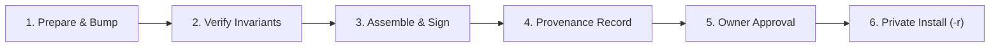

# Small Trader (التاجر الصغير) — Android Release Playbook

This playbook defines the lean, bounded release, versioning, signing, and update procedure for the **Small Trader Android application** (`applicationId = "com.aistudio.smalltrader.psdukx"`). It enforces data-safe in-place updates, rigorous provenance tracking, and explicit decoupling from backend deployments without burdensome bureaucracy.

---

## 1. Identity, Versioning & Tagging Scheme

### 1.1 Permanent Application Identity & Key Custody Decision
* **Application ID**: `com.aistudio.smalltrader.psdukx` (defined in `app/build.gradle.kts`).
* **Critical Update Invariant**: The `applicationId` and the **production release-signing certificate** must remain **permanently identical** across all distributed builds.
* **Why Uninstall Is Prohibited**: Changing either the `applicationId` or the signing key triggers an Android OS install conflict:
  ```text
  INSTALL_FAILED_UPDATE_INCOMPATIBLE
  ```
  Resolving this via uninstallation wipes the app sandbox directory (`/data/data/com.aistudio.smalltrader.psdukx/`). This irreversibly destroys:
  1. Room database records (including un-synced offline sales outbox events and GRN transactions).
  2. In-progress sales drafts and local catalog state.
  3. Encrypted tenant credentials, session tokens, and merchant device preferences.
  **Uninstall cannot be used as an update or recovery procedure.** Permanent identity and key custody must be established before issuing the first pilot APK.

### 1.2 Version Properties & Tag Alignment
Versioning adheres strictly to official Android standards ([Android Developers: Version your app](https://developer.android.com/studio/publish/versioning)):

| Property | Gradle Location | Type / Constraint | Purpose & Semantic Rule |
| :--- | :--- | :--- | :--- |
| **`versionCode`** | `defaultConfig.versionCode` | 32-bit positive integer (`1, 2, 3...`) | Evaluated by Android OS to allow updates. **Must strictly increase** with every distributed APK (including all pilot candidates and hotfixes). Never reused or decremented. |
| **`versionName`** | `defaultConfig.versionName` | String (`0.1.0-pilot.1`, `0.1.0`) | User-visible display version in app info and UI. Must match the git tag **without the leading `v`**. |
| **Git Tag** | Repository tag | `vMAJOR.MINOR.PATCH[-PRERELEASE]` | Canonical release tag (e.g., `v0.1.0-pilot.1` for pilot candidate, `v0.1.0` for stable pilot baseline). *Note: version strings here are convention examples, not claims of existing releases.* |

*Current repo baseline in `app/build.gradle.kts`: `versionCode = 1`, `versionName = "1.0"`.*

---

## 2. Build Variants & Signing Audit

Audited directly against `app/build.gradle.kts`:

```text
buildTypes:
├── debug      -> Signed with debugConfig (debug.keystore)
├── benchmark  -> Inherits release optimization (R8 minification, resource shrinking)
│                 BUT explicitly signed with debugConfig (insecure debug key)
└── release    -> Signs with 'release' signingConfig (production keystore)
                  UNLESS smalltrader.allowInsecureDebugSigningForRelease=true is passed
```

### 2.1 The Pilot Signing Rule
* **Benchmark & Debug Builds Are NOT Pilot-Ready**: While the `benchmark` variant produces an optimized, minified APK, it is signed with the public Android debug key (`debug.keystore`). It is intended exclusively for local performance benchmarks and code profiling.
* **Release Signing Requirements**: Every distributed pilot APK must be built using the `release` build type with genuine release key credentials passed via environment variables or Gradle project properties:
  - `KEYSTORE_PATH` (or `MYAPP_UPLOAD_STORE_FILE`): Absolute path to the keystore file.
  - `STORE_PASSWORD`: Keystore password.
  - `KEY_PASSWORD`: Key password (alias `upload`).
* **Advanced Deferred Topics**: Key rotation lineages via APK Signature Scheme v3+ (`apksigner rotate`) and target SDK migrations are deferred until post-pilot operations.

---

## 3. Minimal Release & Verification Sequence

Follow this bounded 6-step playbook for preparing and distributing every pilot release:



### Step 1: Prepare & Bump Version
1. Verify working directory is clean and aligned with `origin/main`:
   ```bash
   git status
   git rev-parse HEAD
   ```
2. In `app/build.gradle.kts`, increment `versionCode` by 1 and set `versionName` to the target version (e.g. `"0.1.0-pilot.1"`).
3. Commit and tag:
   ```bash
   git commit -m "chore(release): bump version to 0.1.0-pilot.1 (code 2)"
   git tag v0.1.0-pilot.1
   ```

### Step 2: Test & Verify Invariants
Run the verified JVM unit and regression test suite:
```bash
./gradlew :app:testDebugUnitTest
./gradlew :app:lintDebug
```
*Verification status: The JVM test suite executes 140 tests (139 passed, 1 skipped). Lint completes with 0 errors.*  
*Known visual limitation: Do not execute `NativeVisualEvidenceTest` in unverified emulator environments; it has a known idle hang at `capture_16`. Fresh visual passes are not claimed.*

### Step 3: Secure Build & Signature Verification
Assemble the signed release APK using protected credentials:
```bash
KEYSTORE_PATH="/path/to/smalltrader-release.jks" \
STORE_PASSWORD="<keystore-password>" \
KEY_PASSWORD="<key-password>" \
./gradlew :app:assembleRelease
```
Verify the signature and certificate integrity using official Android SDK tools ([Android Developers: apksigner](https://developer.android.com/tools/apksigner)):
```bash
apksigner verify --verbose --print-certs app/build/outputs/apk/release/app-release.apk
```
*Confirm that APK Signature Scheme v2/v3 is enabled and the signer certificate matches the permanent identity.*

### Step 4: Record Immutable Provenance & Checksums
For each candidate APK, calculate its checksum and document the exact provenance record:
```bash
sha256sum app/build/outputs/apk/release/app-release.apk
```
Record the resulting metadata block:
```text
Source Git SHA:        <40-character commit SHA>
Git Tag:               vMAJOR.MINOR.PATCH[-PRERELEASE]
versionName:           MAJOR.MINOR.PATCH[-PRERELEASE]
versionCode:           <integer>
applicationId:         com.aistudio.smalltrader.psdukx
Build Variant:         release
Signing Mode:          release (official keystore)
Signer SHA-256:        <SHA-256 certificate fingerprint from apksigner>
APK SHA-256:           <SHA-256 hash of app-release.apk>
File Size:             <bytes>
```

### Step 5: Owner Approval Gate
Submit the provenance record and release notes to the repository owner for formal sign-off. Do not distribute without explicit approval.

### Step 6: Private Distribution & In-Place Installation
* **Controlled Channel**: Deliver the verified APK exclusively through private, controlled distribution channels to pilot merchants. Do not publish to public channels or commit APK binaries to git.
* **In-Place Device Update**:
  ```bash
  adb install -r app-release.apk
  ```
  *(The `-r` flag reinstalls the package while preserving all application data, databases, and keystore records).*

---

## 4. In-Place Update Verification & Data Safety

Before distributing any update to pilot merchants, execute an in-place update verification on a staging device pre-populated with active merchant data:

1. **Room Outbox & Pending Events**:
   - Verify that all unsynced offline mutations in the Room database (offline sales, inventory movements, GRN receipts) persist completely after `adb install -r`.
   - Verify that the sync engine resumes retry timers without dropping in-flight requests or losing unacknowledged (ACK-pending) records.
2. **Sales Drafts & Basket State**:
   - Verify that in-progress drafts (`SaleDraft`) and draft line items remain loadable and editable after the update.
3. **Tenant & Auth Credentials**:
   - Verify that merchant tenant identity, stored access tokens, and device UUIDs stored in `SharedPreferences` remain readable without requiring re-login.
4. **Database Schema Migrations**:
   - Room migrations must be strictly additive and tested with Room migration validation tests.
   - Never roll back or downgrade an Android APK database without a tested forward-compatible migration path.

---

## 5. Decoupled Versioning, Compatibility & Rollback SOP

To avoid operational deadlocks, maintain strict separation between the three independent version tracks:

```text
┌───────────────────────────────────────┐
│ 1. Android App Version (v0.1.0, code 2)│
└──────────────────┬────────────────────┘
                   │ communicates via
┌──────────────────▼────────────────────┐
│ 2. Mobile Contract Revision (Rev 2)   │  (Manifest SHA ba75352349e5...)
└──────────────────┬────────────────────┘
                   │ implemented by
┌──────────────────▼────────────────────┐
│ 3. Laravel Backend Tag & Deployment   │  (Hostinger deploy via bin/deploy.sh)
└───────────────────────────────────────┘
```

### 5.1 Backward Compatibility Invariants
* **Additive Server Rollouts**: Backend updates deployed to Hostinger must maintain backward compatibility for existing pilot APK versions in the field. API endpoints must handle requests from older pilot APKs gracefully.
* **Fail-Closed Mobile Behavior**: If an APK receives an unexpected or unparseable response from a newer backend release, it must fail closed safely (holding transactions in the offline outbox) rather than corrupting local state.

### 5.2 Practical Rollback SOP
If a critical defect is detected post-release:
1. **Halt Distribution**: Immediately suspend distribution of the new APK to additional merchant devices.
2. **Backend Rollback**: If the regression stems from server-side changes, roll back the backend service to the previous stable release per the backend deployment SOP (`HOSTINGER_DEPLOYMENT_GUIDE.md`).
3. **Forward-Fix Android APK (No Destructive Rollback)**:
   - Android OS does not permit installing an older APK (`versionCode N-1`) over a newer APK (`versionCode N`).
   - Never ask merchants to uninstall the app to roll back, as this destroys their offline sales outbox.
   - Rollback is executed by building a **forward-fix APK** with an incremented `versionCode` (`N+1`), carrying the reverted/fixed codebase.

---

## 6. Standard Release Notes Template

Every pilot release must be accompanied by concise release notes using this standard 4-bullet structure:

```markdown
### Small Trader Android — Release v0.1.0-pilot.1 (versionCode 2)

- **Summary & Purpose**: Bounded pilot candidate introducing Room outbox persistence foundation and Arabic RTL product search enhancements.
- **What's New / Changes**:
  * Integrated Room database outbox schema for pending sync events.
  * Added normalized Arabic prefix search for merchant product catalog.
- **Known Limitations & Non-blocking Gaps**:
  * Live HTTP synchronization and WorkManager background sync are currently disabled.
  * CameraX barcode capture and Bluetooth ESC/POS printing remain in interactive simulation mode.
  * Financial public line TaxRateID schema gap blocks live backend sales sync.
- **Installation & In-Place Update Requirements**:
  * Install directly over existing build via `adb install -r`.
  * Do NOT uninstall previous build (preserves local drafts and database).
- **Artifact Provenance**:
  * Source Commit: `79c9bb348f7ad4840842aa077f1820f75745d2a0`
  * APK SHA-256: `<hash>`
  * Signer Cert SHA-256: `<fingerprint>`
```

---

## 7. Current Integration Status & Pilot Release Gates

### 7.1 Integration Drafts Status
As of baseline `79c9bb348f7ad4840842aa077f1820f75745d2a0`:
* **PR #4 (Contract Rev 2)**: Mobile contract revision 2 manifest (`ba75352349e552f53b02ad7159570171f88943dc26e5bdf2a4b013386b0d0659`) coordinates exact endpoint signatures.
* **PR #5 (Exact Primitives)**: Enforces exact decimal financial quantities and cent calculations.
* **PR #6 (Outbox Foundation)**: Introduces Room database outbox tables, but remains **UNWIRED** (not connected to live network client or automatic sync workers).
* **PR #7 (Product Picker)**: Fast bounded search UX under review.

### 7.2 Remaining Gates Prior to Production Pilot Release
The application is currently a working prototype and is **not yet production-pilot ready**. The following gates remain open:
1. **Network & Sync Engine**: Native authentication, live HTTP client (Retrofit/OkHttp), and WorkManager background sync workers must be wired and tested.
2. **TaxRateID Financial Gap**: Resolve the backend public line `TaxRateID` requirement on write endpoints before enabling live offline sync.
3. **Physical Hardware Validation**: CameraX physical barcode scanning and Bluetooth thermal ESC/POS printing must be validated on actual physical Android hardware (currently simulated).
4. **End-to-End Stress & Storage Testing**: Execute real-device update tests, network partition recovery tests, and SQLite/Room disk exhaustion handling.
5. **Visual Suite Stabilization**: Resolve the `NativeVisualEvidenceTest.capture_16` idle hang to re-enable automated visual regression coverage.

---

## 8. Cross-Repository References & Documentation Links

### 8.1 Backend Release & Deployment Procedures
Cross-reference the backend release documentation in the `Bassamalsaqqa/account` repository:
* `HOSTINGER_DEPLOYMENT_GUIDE.md` — Hostinger Cloud server setup and `bin/deploy.sh` pipeline.
* `CONTROLLED_RELEASE_CHECKLIST.md` — Backend deployment checklists and rollback verification.
*(Cross-linking coordinated with Backend Codex supervisor thread `[Small Trader Laravel mobile integration — Codex supervision](t3-thread://v2/32fc517e-67b4-4fec-863a-ec803da43c1a/mcp:launch:b115bd8718ab7f51886265350a7b0857916a47e0a36980a0007bee341c2edd6f)`).*

### 8.2 Official Android Documentation
* [Android Developers: Version your app](https://developer.android.com/studio/publish/versioning) — Official guide on `versionCode`, `versionName`, and upgrade mechanics.
* [Android Developers: Sign your app](https://developer.android.com/studio/publish/app-signing) — Official guide on Android keystore configuration and release signing.
* [Android Developers: apksigner](https://developer.android.com/tools/apksigner) — Official documentation for APK signature verification and certificate inspection.
